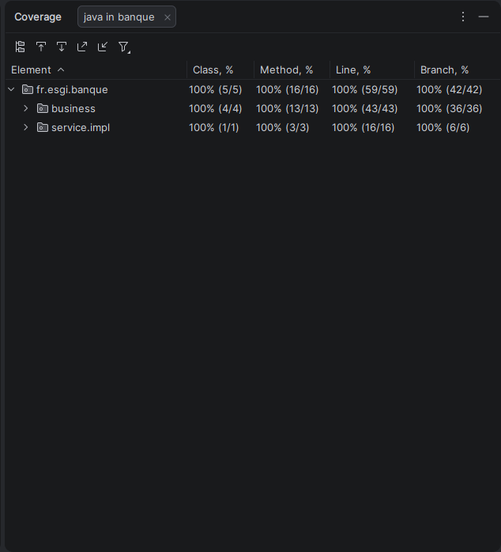

# Rendu : tests unitaires et TDD

- **Nom :** Varoqueaux
- **Prénom :** Axel
- **Campus :** Reims
- **Dépôt :** https://github.com/AxelVaroqueauxx/Tests_Unitaires_Banque_Eval

## Partie A : défauts trouvés et corrigés

Pour chaque défaut, le commit `test:` qui échoue précède le commit `fix:`.

| N° | Règle | Classe | Description du défaut | Test qui le prouve |
|----|-------|--------|-----------------------|--------------------|
| 1 | C3 | `Compte` | `crediter` acceptait un montant de 0 (`signum() < 0` au lieu de `<= 0`). | `shouldRejectNonPositiveAmountWhenCrediting_C3` |
| 2 | C5 | `Compte` | `debiter` refusait un débit amenant le solde exactement à `-découvertAutorisé` (`<= 0` au lieu de `< 0`). | `shouldAcceptDebitUpToOverdraftLimit_C5`, `shouldAllowEmptyingAccountWhenNoOverdraft_C5` |
| 3 | C6 | `Compte` | `estVide` utilisait `equals(BigDecimal.ZERO)`, qui compare aussi l'échelle : un solde `0.00` n'était pas vide (corrigé avec `signum() == 0`). | `shouldBeEmptyWhenBalanceIsZeroWhateverTheScale_C6` |
| 4 | F3 | `CalculFrais` | La gratuité de la tenue s'appliquait aussi à 26 ans (`<= 26` au lieu de `< 26`). | `shouldWaiveFeeOnlyForHoldersUnder26_F3` |
| 5 | F4 | `CalculFrais` | Un solde moyen de 1 000 € exactement ne donnait pas la gratuité (`> 1000` au lieu de `>= 1000`). | `shouldWaiveFeeWhenAverageBalanceReaches1000_F4` |
| 6 | F5 | `CalculFrais` | Quand la tenue était offerte, la méthode renvoyait 0 sans ajouter le supplément premium de 5 €. | `shouldAlwaysChargePremiumSupplement_F5` |

Les règles C1, C2, C4, C7, F1 et F2 étaient déjà respectées par le code : leurs tests passent dès leur écriture.

## Partie B : service de virement en TDD

| Règle | État | Remarque |
|-------|------|----------|
| V1 | Terminée | Cycle `red:` puis `green:`. |
| V2 | Terminée | Cycle `red:` puis `green:`. |
| V3 | Terminée | Cycle `red:` puis `green:`. |
| V4 | Terminée | Cycle `red:`, `green:`, puis `refactor:` (extraction de `trouverCompte`). |
| V5 | Non terminée | Pas de test dédié. Le comportement est déjà obtenu par construction : `Compte.debiter` lève `SoldeInsuffisantException` avant toute sauvegarde. |
| V6 | Non terminée | Alerte au-dessus de 10 000 €, non commencée. |
| V7 | Non terminée | Refus le dimanche, non commencée. |

### Règles de la partie B non terminées

- **V5** : pas de test dédié (voir ci-dessus).
- **V6** : alerte au titulaire de la source pour un virement strictement supérieur à 10 000 €.
- **V7** : aucun virement accepté le dimanche (`VirementRefuseException` à créer, et aucun compte sauvegardé).

## Couverture de code




## Exécution des tests

```
mvn test
```

Le projet vise Java 17 (voir `pom.xml`, non modifié).
